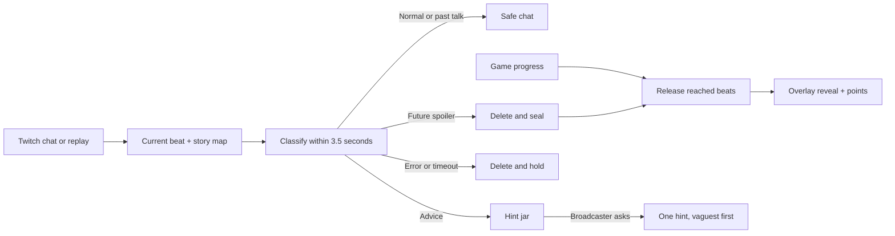

# Spoiler vault

Spoiler Vault keeps story spoilers out of a streamer's chat until the story
catches up. It knows the current beat, holds future reveals, and gives their
authors points when those reveals happen. Advice goes into a hint jar. The
streamer decides when to ask for it.

## 60 second offline replay

Use Node 20. No Twitch account or API key is needed.

```sh
cd ~/spoiler-vault
nvm use
npm ci
npm run replay -- --offline --manual
```

Open [the dashboard](http://localhost:3000/dashboard/),
[the game](http://localhost:3000/game/) and
[the overlay](http://localhost:3000/overlay/).
`--manual` lets you control the story while messages arrive. Leave it out for
a scripted run. Stop with Ctrl+C. A new replay starts with an empty SQLite session.

The game is The Orison file, our own six-beat lighthouse mystery. There are
puzzles at beats 2 and 4. The next-beat button also works as a demo control.
N advances a beat. H releases the next hint. The dashboard never shows held
spoiler text, even after release. The overlay does the reveal.

For an overlay preview without a server connection, open `/overlay/?demo=1`.
It cycles sample events. Add `&scene=toast`, `hint`, `reveal` or `leaderboard`
to preview one scene.

## Live Twitch setup

1. Register a confidential app in the
   [Twitch developer console](https://dev.twitch.tv/console/apps).
   Use `http://localhost:3000/auth/callback` as the redirect URL.
2. Copy `.env.example` to `.env`. Fill the Twitch client ID, secret, channel login
   and OpenAI key. Keep PORT=3000 for that callback URL. The example lists all
   seven required settings. OPENAI_MODEL defaults to gpt-4o-mini.
3. Run `npm run dev`, or `npm run build && npm start`.
4. Open [Connect Twitch](http://localhost:3000/auth/login) as the channel owner.
   Grant user:read:chat, user:write:chat, moderator:manage:chat_messages and
   moderator:manage:chat_settings. The broadcaster identity also sends bot replies.
5. Check the connection label. The app sets a six second non-mod delay before
   subscribing to chat. Try a message from a second, non-mod account.
6. Play the game or advance the beat from the desk. Type `!hint` as the broadcaster
   to release one piece of advice. Viewer commands do not release hints.

This uses no Affiliate-only feature. A real account run still needs credentials.
Tokens are refreshed and saved with mode 600 in ignored `.data/`. The live SQLite
session persists too. If you replace the story map, stop the app and rename `.data`
to `.data-archive` before starting a new session. Never commit `.env` or tokens.

## How it works



Each revealed message earns one point. The first person to seal a beat gets three
extra points when it opens. The bonus is saved once. Jumping ahead releases earlier
beats too. Repeating a progress call does not repeat awards.

The wire formats are in `docs/CONTRACT.md`. They have no extra fields.
`/api/desk` supplies safe row metadata, redacted vault lengths, jar levels and
classifier stats. `/api/session` hides future chapter names. The six-beat game
keeps its answer checks on the server.

## Eval results

The fixture has 150 unique synthetic messages for this story. The table below is
an offline heuristic baseline. It does not measure the OpenAI model. The baseline
does not read the expected labels.

| Label | Precision | Recall | F1 |
| --- | ---: | ---: | ---: |
| normal | 0.722 | 0.975 | 0.830 |
| past_talk | 1.000 | 0.829 | 0.906 |
| future_spoiler | 1.000 | 1.000 | 1.000 |
| backseat | 0.963 | 0.743 | 0.839 |

Baseline latency p50: 0.01 ms. p95: 0.02 ms.


Run `npm run eval` with a key for real model results. It reports precision,
recall, F1, confusion, release-target accuracy and latency p50/p95. Failed and
uncertain calls count as pending misses. Classification latency excludes Twitch
API calls. `npm run eval -- --offline` runs the baseline. Both write
`eval/results.md` and `eval/results.json`.

## How we used Codex

Codex scaffolded the server, wrote the OAuth and EventSub integration, and built
the first dashboard. We used it again to audit the contract, write the original
case file, replace the screens, and run local tests and screenshot checks.
We gave it the design tokens, layout and motion timings. The audit records what
was checked and what still needs a real account.

## Known limits

- Live Twitch login, non-Affiliate deletion and OpenAI accuracy still need keys
  and a real end-to-end check. No model score has been invented.
- Delivery lag, rate limits and API errors can let a message appear before it is
  deleted. Moderator and broadcaster messages have different Twitch rules.
- Pending items remain private in SQLite. There is no review screen yet.
- A dropped EventSub connection loses messages Twitch does not replay. A missed
  overlay animation is not replayed on reconnect.
- The six second Twitch delay remains enabled after shutdown. Turn it off in
  Twitch's chat settings when finished.
- Replay labels test the product flow. They do not measure classification quality.
  The timeout rows are explicit fixture simulations.
- These are local controls. The app binds to 127.0.0.1 and checks Host and Origin.
  It is not an internet-facing account service.

Run `npm run typecheck`, `npm test` and `npm run build` for code checks. The
Playwright verification is documented in `docs/AUDIT.md`. All screens use the
shared tokens and locally served IBM Plex fonts from Google Fonts, under their
included font licenses. The icons, game text and overlay motion are our own.
