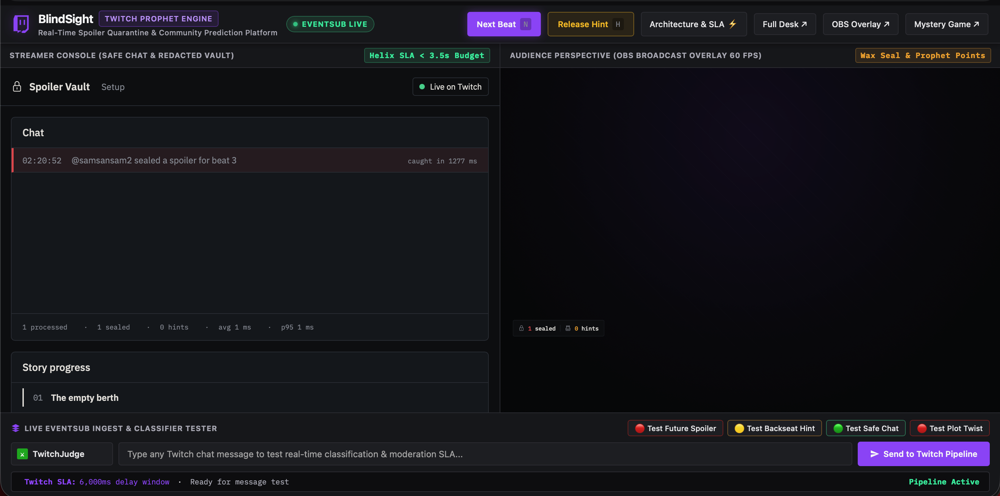
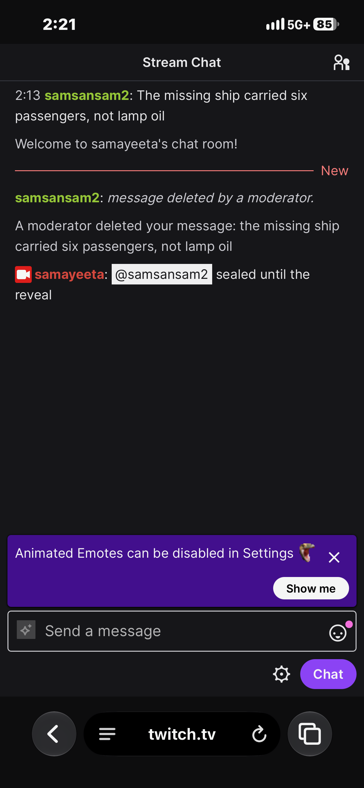
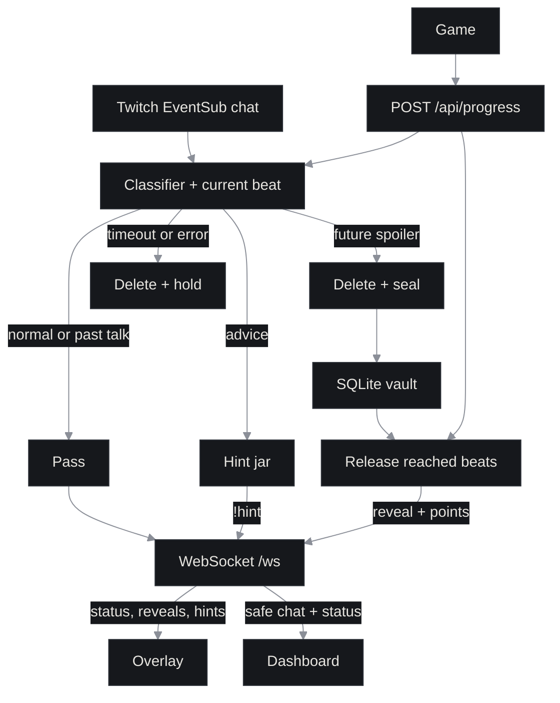

# Spoiler Vault showcase: The Twitch Prophet Engine

> Real-time spoiler quarantine, backseat hint jar, and community prediction reveals for Twitch story streams.

<p align="center">
  
  
  
  <a href="LICENSE"></a>
  
  
</p>

Story-game chat spoils plot twists and drops unsolicited advice before streamers ask for it. Twitch has never shipped native spoiler tags. Spoiler Vault showcase tracks story progress, holds future spoilers and backseat advice inside Twitch's 6-second non-mod delay, and turns accurate predictions into on-stream reveals and community Prophet points when the broadcaster reaches that story beat.

[TODO: add the full YouTube demo link](https://www.youtube.com/watch?v=TODO_VIDEO_ID).

## What it does

- **Real-Time Quarantine**: Evaluates incoming chat against the active story beat. Spoilers are deleted within Twitch's 6-second non-mod chat delay.
- **Prophet Engine & Reveals**: Sealed predictions crack open with wax seal animations on the stream overlay when the story beat is unlocked, awarding Prophet points and leaderboard status to viewers who called it early.
- **Backseat Hint Jar**: Quarantines unsolicited advice into a tiered hint jar (`vaguest` to `direct`). The streamer accesses advice only when prompted (`!hint` or dashboard button).
- **Safe Chat for Streamers**: Broadcaster and moderator consoles display a redacted safe chat feed so streamers never get spoiled.
- **Universal Story Mapper**: Generates dynamic story beat maps for any game using structured OpenAI output or custom beat maps.

### Core Interfaces
- **[Spoiler Vault showcase](http://localhost:3000/showcase/)**: Unified split-screen interface featuring the Streamer Console with Safe Chat and the OBS Broadcast Overlay side-by-side, along with a live EventSub ingest tester and SLA telemetry waterfall.
- **[Streamer Dashboard](http://localhost:3000/dashboard/)**: Broadcaster controls, safe redacted chat, story progress tracking, and on-demand hint jar.
- **[OBS Stream Overlay](http://localhost:3000/overlay/)**: 1080p transparent browser source with animated wax seals, Prophet reveals, and community points.
- **[The Orison File (Mystery Game)](http://localhost:3000/game/)**: An interactive 6-beat lighthouse mystery game demonstrating real-time spoiler detection.

## Tested live

In our live Twitch test, a viewer spoiler was deleted. The bot replied
"sealed until the reveal", and the dashboard showed "caught in 1277 ms".

<table>
  <tr>
    <td width="50%" valign="top"><br><sub>Dashboard: the spoiler was caught in 1277 ms.</sub></td>
    <td width="50%" valign="top"><br><sub>Twitch chat: the spoiler was deleted and the bot replied.</sub></td>
  </tr>
</table>

## Try it in 60 seconds

Use Node 20. No Twitch account or API key is needed.

```sh
git clone https://github.com/iPrakharV/spoiler-vault.git
cd spoiler-vault
nvm use
npm ci
npm run replay -- --offline --auto
```

Open [the dashboard](http://localhost:3000/dashboard/) and [the overlay](http://localhost:3000/overlay/) before the first reveal, or explore [the Spoiler Vault showcase](http://localhost:3000/showcase/) for a side-by-side view with live pipeline tester. Chat starts after two seconds. The story advances through b2 to b6 in about 90 seconds, with reveals, points and a leaderboard. The server stays open afterward. Ctrl+C stops it.

[The game](http://localhost:3000/game/) is our original mystery, The Orison file. To play it at your own pace, leave out `--auto`. **N** advances a beat. **H** releases a hint. Each replay starts fresh.

## Use it with any game

Open **Setup** in the dashboard. Enter the game and, optionally, how far you are.
The server builds 8 to 12 beats with OpenAI and picks a starting beat from that note.
You only see beat numbers. Summaries and secrets stay on the server in ignored
`story/generated/`. A map change clears the vault, hint jar and points.
Use **Next beat** as you play. The dropdown restores the demo map.

Set `OPENAI_API_KEY` in `.env` to enable generation. Generated maps can miss or
misplace plot details. Real game coverage has not been checked yet.

## Run it live on Twitch

1. Enable **2FA** on the broadcaster's Twitch account. Twitch requires it to [register an app](https://dev.twitch.tv/docs/authentication/register-app/).
2. In the [developer console](https://dev.twitch.tv/console/apps), register a confidential app. Set its redirect URL to **`http://localhost:3000/auth/callback`**, exactly.
3. Copy `.env.example` to `.env`. Fill `TWITCH_CLIENT_ID`, `TWITCH_CLIENT_SECRET`, `TWITCH_CHANNEL` and `OPENAI_API_KEY`. `OPENAI_MODEL` defaults to `gpt-4o-mini`. Keep `PORT=3000`. Do not commit `.env`.
4. Run `npm run dev`. Open [Connect Twitch](http://localhost:3000/auth/login) and sign in as the broadcaster. Bot replies use that same account.
5. Confirm **Live on Twitch** on the dashboard. The server enables a **six second non-mod chat delay** before subscribing. Check that setting in Twitch too.
6. Test chat with an **alt account that is not a moderator**. Broadcaster and moderator messages have different delay and deletion rules.
7. In OBS, add a **Browser source** with URL `http://localhost:3000/overlay/`, width **1920**, height **1080**. The page background is transparent. Use the dashboard as the streamer's safe chat feed.
8. Advance with the game or **N**. Type `!hint` as the broadcaster, or use **H** on the dashboard. Turn off the Twitch delay in chat settings when you are done.

<details>
<summary>Scopes and local checks</summary>

The app requests `user:read:chat`, `user:write:chat`, `moderator:manage:chat_messages`, `moderator:manage:chat_settings` and `clips:edit`. Tokens are refreshed and stored with mode 600 in ignored `.data/`. No Affiliate-only API is used.

```sh
npm run typecheck
npm test
npm run build
```

A compiled server starts with `npm start`. `/overlay/?demo=1` previews sample overlay events without a Twitch or API connection. The [audit](docs/AUDIT.md) records the checks and remaining credential-dependent tests.

</details>

## Reveal clips

Each live reveal requests one Twitch clip without holding up the reveal. Log in
again at `/auth/login` to grant the new `clips:edit` scope. Enable clips in Twitch's
stream settings. The dashboard links the last clip. A short overlay line credits
the prediction's author. Failed requests stay on the dashboard and in the log.
Replay uses a placeholder link labeled **replay clip**, with no Twitch call.
[Twitch creates clips asynchronously](https://dev.twitch.tv/docs/api/clips/), so a returned link can take a moment to work.

## How it works



Twitch holds non-mod messages for six seconds, giving the bot time to delete spoilers before viewers see them. The classifier gets reached summaries and future secrets, with a 3.5 second timeout. Timeouts, errors and low confidence trigger deletion and a private pending hold. Reached beats open on the overlay and award +1 per message, plus +3 for the first call. Delivery lag, permissions and API errors can still let a message through.

## Accuracy

**Offline heuristic baseline**, 150 synthetic messages for this story. These numbers do not measure the OpenAI model. The baseline reads the story map, not the expected labels.

| Label | Precision | Recall | F1 |
| --- | ---: | ---: | ---: |
| `normal` | 0.722 | 0.975 | 0.830 |
| `past_talk` | 1.000 | 0.829 | 0.906 |
| `future_spoiler` | 1.000 | 1.000 | 1.000 |
| `backseat` | 0.963 | 0.743 | 0.839 |

| Run | Latency p50 | Latency p95 |
| --- | ---: | ---: |
| Offline baseline | 0.01 ms | 0.03 ms |
| Real OpenAI model | Not run | Not run |

**Real model results are not available yet.** They require `OPENAI_API_KEY`. Baseline timings are local rule checks, not API latency. The saved [report](eval/results.md) includes the confusion matrix and release-target count.

<details>
<summary>Rerun the eval</summary>

```sh
# No key: heuristic baseline.
npm run eval -- --offline

# With OPENAI_API_KEY in .env: real model.
npm run eval
```

Both write `eval/results.md` and `eval/results.json`. Pending predictions count as misses. Latency includes errors and timeouts, but excludes Twitch deletion and replies. The fixture is synthetic and story-specific. It is not a production benchmark.

</details>

## How we used Codex

- Codex wrote the server, OAuth and EventSub integration, classifier plumbing, replay and tests.
- We set the contract, failure policy, design tokens, screen layouts and motion timings. We reviewed the output against that spec.
- Codex drafted the original game from our lighthouse premise. We added checks for redaction, points, hint order and automatic reveals.
- Review caught replay defaults, hint state and reveal timing bugs. We fixed them and checked fresh Playwright captures.
- Session ID: **TODO: add the Codex session ID**.

## Project layout

```text
.
├── server/      Chat pipeline, Twitch, SQLite and local APIs
├── dashboard/   Safe chat and broadcaster controls
├── overlay/     OBS browser source and reveal animations
├── showcase/    Spoiler Vault showcase with two panes and SLA waterfall
├── game/        The Orison file
├── story/       Beat map, secrets and game scenes
├── fixtures/    Replay messages and 150 eval labels
├── eval/        Harness and saved baseline results
├── shared/      Tokens, SVG icons and licensed fonts
├── scripts/     Browser checks and media capture tools
└── docs/        Contract, audit and project media
```

## Known limits

- Real model accuracy still needs a credentialed eval run.
- Delay exemptions, network gaps and API failures can let a spoiler through. EventSub does not replay missed messages.
- Pending holds stay private in SQLite. There is no review screen yet.
- Replay labels demonstrate the flow. The timeout rows are explicit simulations.
- The app is local. It binds to `127.0.0.1`; it is not an internet-facing account service.

## Team

| Name | Role |
| --- | --- |
| Prakhar Verma | Full-stack engineering, Twitch integration (OAuth, EventSub, Helix moderation), classifier & eval pipeline, streamer dashboard |
| Samayeeta Maitra | Full-stack engineering, stream overlay & interactive UI, mystery game engine, story design, demo & documentation |

Built for the Codex x TwitchCon Hackathon 2026.

License: [MIT](LICENSE). The IBM Plex fonts retain their included [OFL licenses](shared/fonts/).
